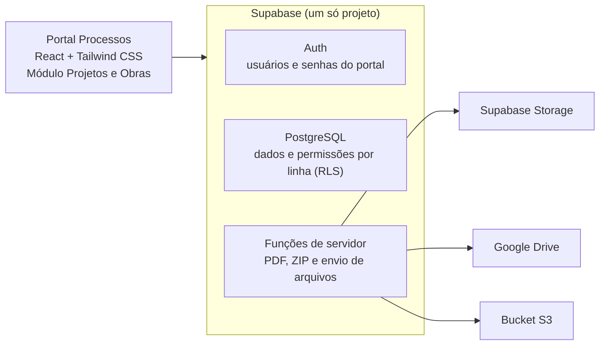
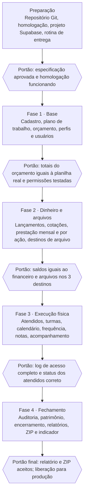

# Especificação — Projetos e Obras (React + PostgreSQL + Tailwind)

Versão de 26/11/2026. Este documento define o que será construído no módulo Projetos e Obras do Portal Processos, a partir do protótipo validado, e em que ordem.

## 1. Visão e escopo

O módulo controla projetos executados com recursos de parceiros (termos de fomento, convênios, patrocínios): do recebimento do plano de trabalho à prestação de contas final, com orçamento, lançamentos, execução física (aulas, eventos, atendidos) e auditoria.

**Quem usa:** coordenadores, gestores, assistentes de lançamento, analistas financeiros, auditores, professores e equipe técnica (psicologia, pedagogia), financeiro e diretoria. O que cada um vê e faz é definido por perfis de funções, criados pelo administrador.

**Dentro do escopo:**

- Cadastro do projeto com etapas: elaboração, parametrização, execução e encerramento.
- Plano de trabalho: ações, metas e indicadores.
- Orçamento em fluxo de caixa mensal, com verbas, itens, receitas, rendimentos e bloqueio de itens.
- Lançamentos com comprovantes e cotações (inicial e na prestação).
- Prestação de contas por ação, calendário, atendidos (alunos e atendidos), turmas, frequência e notas.
- Patrimônio do projeto, auditoria, relatórios e indicadores.
- Arquivos em destinos configuráveis: Supabase Storage, Google Drive ou bucket S3.

**Fora do escopo desta versão:** contabilidade completa, folha de pagamento, emissão de nota fiscal e integração bancária automática.

**Premissa:** o protótipo (dados fictícios, arquivo em `prototipo/`) é a referência de comportamento. Onde esta especificação divergir dele, vale o que está escrito aqui.

## 2. Arquitetura

Cada arquivo guarda o destino onde foi salvo; trocar o principal não move os antigos.

Decisões: **Supabase** hospeda banco, login e funções de servidor; o módulo entra no portal com o mesmo login; há **uma única organização**. O código vai para um repositório Git, com migrações SQL versionadas e um ambiente de homologação separado da produção.

- **Front-end:** React com TypeScript e Tailwind CSS. A regra de negócio crítica (saldos, travas, permissões) não fica só na tela: o banco e as funções também a aplicam.
- **Banco:** PostgreSQL com tabelas relacionais e chaves estrangeiras. JSON só para campos realmente livres, como o texto da prestação.
- **Arquivos:** nunca no banco. O banco guarda o caminho e o destino; o arquivo vai para o Storage, o Drive ou o bucket, conforme a tela de Administração.
- **Funções de servidor:** envio aos destinos (as chaves ficam só aqui), geração de relatório em PDF, ZIP de comprovantes com índice e envio de avisos.

## 3. Perfis e permissões

O acesso é definido por **funções**. O administrador cria um perfil (cargo), marca as funções e vincula o perfil ao usuário, informando se ele vê todos os projetos ou só alguns. Nenhuma regra depende do nome do cargo: o código só pergunta se o usuário tem a função.

**Regras gerais**

- As abas visíveis vêm das funções `ver_*`; sem a função, a aba não aparece e o banco também nega o dado.
- `ver_valores` é uma única opção (vê ou não vê valores). Sem ela, valores aparecem escondidos.
- O sistema impede remover a função de administração do último administrador ativo.
- Toda mudança de perfil, usuário ou projeto liberado vai para o histórico de permissões.
- Quando uma tela nova é criada, sua função entra no catálogo (tabela `funcoes`) por migração; assim a lista cresce sem alterar perfis existentes.

**Catálogo de funções (v1)**

| Grupo | Função | O que permite |
| --- | --- | --- |
| Projetos | `proj_gerir` | Criar, editar e encerrar projetos; concluir etapas |
| Projetos | `cad_edit` | Editar cadastro, documentos, contas, centros de custo e critérios da auditoria |
| Projetos | `ver_inativos` | Ver projetos inativos |
| Plano e orçamento | `plano_edit` | Criar ações e metas |
| Plano e orçamento | `orc_edit` | Criar verbas, itens de custo, tipos e itens de receita; bloquear itens |
| Plano e orçamento | `rem_aprova` | Aprovar remanejamento entre verbas |
| Plano e orçamento | `trava` | Travar e destravar meses |
| Plano e orçamento | `ver_valores` | Ver valores |
| Lançamentos e prestação | `lanc` | Lançar despesas, pedir remanejamento, cadastrar prestadores |
| Lançamentos e prestação | `rcb` | Registrar recebimentos |
| Lançamentos e prestação | `rend_info` | Informar rendimentos |
| Lançamentos e prestação | `lanc_analisa` | Analisar lançamentos e aprovar a prestação do mês |
| Lançamentos e prestação | `prest_enviar` | Enviar a prestação do mês para análise |
| Lançamentos e prestação | `just_aprova` | Aprovar justificativa de falta de 3 orçamentos; avaliar prestadores |
| Lançamentos e prestação | `pc_edit` | Redigir e enviar a prestação por ação |
| Lançamentos e prestação | `pc_ver` | Ver a prestação por ação |
| Lançamentos e prestação | `rel_emite` | Emitir o relatório de execução das ações |
| Calendário e atendidos | `agenda` | Criar e remarcar aulas e eventos; presença e notas |
| Calendário e atendidos | `aluno_gerir` | Atendidos, turmas, inscrições, saídas e transferências |
| Calendário e atendidos | `dados_prot` | Ver dados protegidos dos atendidos |
| Calendário e atendidos | `log_acesso` | Ver o registro de acessos a dados protegidos |
| Calendário e atendidos | `acomp_prof`, `acomp_psi`, `acomp_ped`, `acomp_tudo` | Acompanhamento por tipo; o psicológico é restrito |
| Auditoria e patrimônio | `aud_emite` | Emitir relatórios, abrir e encerrar divergências |
| Auditoria e patrimônio | `aud_resp` | Responder divergências e registrar correções |
| Auditoria e patrimônio | `pat_edit` | Cadastrar e alterar bens |
| Abas | `ver_resumo`, `ver_cad`, `ver_plano`, `ver_orc`, `ver_prest`, `ver_cal`, `ver_alunos`, `ver_acomp`, `ver_aud`, `ver_hist`, `ver_pat`, `ver_prov` | Abrir cada aba (a aba `ver_alunos` chama-se Atendidos) |
| Administração | `acessos_admin` | Administrar perfis, usuários e destinos de armazenamento |

**Perfis iniciais** (ponto de partida; o administrador ajusta): Coordenador de Projetos, Gestor do contrato, Assistente e Analista de prestação de contas, Auditor, Professor, Psicólogo, Pedagoga, Financeiro, Diretoria e Administrador.

## 4. Módulos e regras de negócio

Cada módulo abaixo corresponde a uma aba do protótipo. As regras são as validadas nas rodadas anteriores.

### 4.1 Projeto e etapas

- O projeto passa por quatro etapas: **Elaboração e recebimento**, **Parametrização**, **Execução** e **Encerramento**. Quem tem `proj_gerir` conclui cada etapa.
- Orçamento e plano só são editáveis em Parametrização e Execução; lançamentos só em Execução. Em Encerramento, o projeto fica travado para alterações, exceto o que o próprio encerramento exige.
- O projeto pode ser **inativo**. Inativos ficam fora da lista padrão e só aparecem para quem tem `ver_inativos`.
- Cadastro: dados do projeto, códigos (inclui o **número do processo**), documentos, contas bancárias (banco, agência, conta e observações; pode ser inativada) e centros de custo (código e descrição, por exemplo CC01 — Operação; pode ser inativado), e critérios da auditoria.
- Cada mudança de cadastro e de etapa gera registro no histórico.

### 4.2 Plano de trabalho

- O plano é composto por **ações** (aulas, evento, cadastro ou genérica; a genérica comprova-se por texto formatado com imagens no corpo e anexos de planilhas, imagens e PDF) e, em cada ação, por **metas** com indicador (nº de aulas ou eventos, nº de alunos, frequência média) e alvo.
- O progresso de cada meta é **calculado** dos registros (aulas realizadas, alunos inscritos, presença), nunca digitado.

### 4.3 Orçamento (fluxo de caixa mensal)

- Saldo inicial 0. O orçamento é uma planilha por mês, com verbas e itens de custo e com tipos e itens de receita. Cada célula tem três valores: orçado, realizado e pendente.
- Cada item tem **período** (mês de início e de fim) e recorrência: mensal, única ou personalizada (valor por mês).
- **Saldo por item e por verba** aparece junto à linha do item, calculado como orçado acumulado menos realizado acumulado. Não há quadro de saldo separado.
- **Rendimentos** têm dois modos, escolhidos ao criar o item de receita: **somar** ao total de receitas, ou **reservar** até o fim do contrato. Reservado não entra no total de receitas e aparece em uma linha abaixo de Resultado (receitas − custos).
- **Bloqueio de item:** quem tem `orc_edit` bloqueia um item com justificativa. O texto aparece como "Observação para o usuário" no aviso do item, e o lançamento nele fica impedido.
- **Trava de mês:** quem tem `trava` fecha e reabre meses; mês travado não aceita lançamento nem alteração.
- **Remanejamento** entre verbas é solicitado no lançamento e aprovado por quem tem `rem_aprova`.
- **Documento a anexar no item:** ao criar um item de custo, quem cria escolhe quais documentos entram nos lançamentos dele e quais são obrigatórios. Os padrão são Nota fiscal / recibo, Comprovante de pagamento e Foto (sugestão inicial: NF e comprovante obrigatórios, foto opcional), e é possível acrescentar outros, como contrato ou termo de recebimento. O lançamento só é enviado com os obrigatórios anexados; os opcionais aparecem na lista de anexos mas não bloqueiam. Itens antigos, sem escolha, seguem a regra anterior (NF e comprovante obrigatórios; foto obrigatória só nas verbas que a exigem).
- A planilha pode ser ampliada em tela cheia.

### 4.4 Lançamentos e cotações

- Lançamento de despesa: item, ação do plano (opcional), mês, valor, favorecido (prestador), nota fiscal e comprovante de pagamento. Estados: rascunho, em análise, aprovado, devolvido (com motivo).
- **Cotações:** o item pode exigir 3 orçamentos já na criação. Na prestação de contas, cada lançamento também pode ter 3 cotações (fornecedor, preço, anexo), com marcação da escolhida. O sistema pede nota fiscal e comprovante da cotação escolhida.
- **Sem 3 orçamentos:** exige justificativa, aprovada por quem tem `just_aprova`. Se o item foi criado com essa justificativa (ou com os 3 orçamentos), os lançamentos dele não exigem cotações para serem enviados e aprovados. Elas só são exigidas em cada lançamento quando o item foi marcado com medição mensal (3 orçamentos a cada lançamento).
- Prestadores são cadastrados e avaliados; a avaliação fica no histórico do prestador.
- Recebimentos e rendimentos têm telas e permissões próprias (`rcb`, `rend_info`).
- Fluxo mensal: `prest_enviar` envia o mês; `lanc_analisa` aprova ou devolve linha a linha.

### 4.5 Prestação de contas por ação

- Para cada ação, o responsável escreve o texto da prestação em editor com imagens e anexa documentos. Estados: rascunho, enviada, devolvida (com motivo) e aprovada.
- **Relatório de execução:** o usuário com `rel_emite` escolhe a ação (ou todas) e o período. O relatório traz projeto, parceiro, instrumento e nº do processo; por ação, as metas (alvo, no período, acumulado), a lista de atividades com presença, fotos e documentos, e o texto da prestação. Antes de emitir, avisa o que está sem comprovação. Saída: PDF.
- O lançamento tem um campo opcional de ação; o relatório inclui uma seção de gastos por ação (valor realizado no período, por verba e item) para os lançamentos que indicam a ação.

### 4.6 Calendário, atendidos e turmas

- **Calendário:** aulas e eventos com data, horário, local, instrutor e ação. Só aulas ou eventos de datas passadas aceitam registro de presença, fotos e documentos. Cancelar e remarcar ficam registrados.
- **Turmas:** letra, curso, professor, data de início e previsão de término, horário, máximo de alunos e observações. A **vaga só abre quando um aluno registra saída ou transferência**.
- **Atendidos** (aba antes chamada Alunos): cada cadastro é classificado como aluno ou atendido, com foto opcional e documentos pessoais (CPF, RG, CNH, comprovante de residência, atestado, certidão, currículo, certificado e outros) guardados na área restrita. A lista tem uma coluna de classificação e filtro por aluno ou atendido, com a contagem de cada um. A foto pode ser incluída no cadastro ou depois. Uma pessoa pode participar de mais de uma ação, marcadas no cadastro ou depois por inscrição. Há também turmas, saída, transferência, desativação e reativação. Cada desativação e reativação abre e fecha um período de pausa, e o status vem do período vigente (corrige o erro de reativar e desativar de novo).
- **Frequência e notas** por aula, por aluno.
- **Dados protegidos** (documentos, endereço, responsáveis, saúde) só com `dados_prot`; cada consulta grava no registro de acessos.
- **Acompanhamento** por professor, psicólogo e pedagogo, cada tipo com sua permissão. O psicológico só é visto por quem tem `acomp_psi` ou `acomp_tudo`.

### 4.7 Auditoria, patrimônio e encerramento

- **Auditoria:** o auditor emite relatórios segundo os critérios do cadastro, abre divergências e as encerra; o responsável responde e registra a correção.
- **Patrimônio:** bens comprados com recursos do projeto (descrição, valor, data, local, estado), com detalhe e baixa. O cadastro de bens é o do módulo Ativos do portal, com vínculo ao projeto; a tabela `bens` do modelo vira esse vínculo.
- **Encerramento:** confere pendências, registra o destino dos bens e do saldo e bloqueia o projeto.

### 4.7a Layout da interface

- **Barra lateral escura** com ícones, fixa à esquerda: Projetos; dentro de um projeto, as telas agrupadas em Gestão, Execução e Controle (com contadores de pendência); Administração para quem tem permissão. No celular ela vira menu que abre e fecha.
- **Topo** com busca (projetos, telas do projeto e administração) e o usuário com a troca de perfil ("Ver como", só no protótipo).
- **Cabeçalho da página** com trilha de navegação (Projetos / projeto / tela), título e dados do projeto.
- **Etapas do projeto** como linha do tempo com círculos numerados.
- **Painel de resumo** à direita nas telas largas (parceiro, instrumento, etapa, período, versão, lançamentos); some no Orçamento para dar espaço à planilha.
- Inspirado em layout de referência do Portal Tripolo (barra lateral, cartões, resumo lateral), adaptado às telas deste módulo.

### 4.8 Arquivos e armazenamento

- **Nome padrão:** todo arquivo salvo recebe `<nº do processo>_<ddmmaaaaHHMM>_<nome original>` (por exemplo `004512_251120261412_nota.pdf`). O número do processo entra sem o ano na frente (2026/004512 vira 004512), porque a data completa vem logo depois; se o projeto não tiver nº de processo, usa o código do projeto. O nome inteiro tem no máximo 80 caracteres: o trecho do nome original é cortado, preservando a extensão, e acentos e caracteres especiais são trocados por letras simples e sublinhado.
- **Imagens:** o navegador reduz para no máximo 1600 px no lado maior, JPEG com qualidade 75%, **mantendo os metadados (EXIF)**.
- **PDFs e outros arquivos** não são barrados por tamanho; o usuário não precisa fazer nada. A otimização de PDF grande, se necessária, é feita no servidor.
- **Destinos:** a tela de Administração cadastra vários destinos dos tipos Supabase Storage, Google Drive e bucket S3-compatível, cada um com seus parâmetros e modelo de pastas (`{processo}`, `{ano}`, `{mes}`, `{ano-mes}`, `{verba}`, `{item}`, `{acao}`).
- Um destino só vira **principal** ou **cópia de segurança** depois de passar no teste de conexão. O arquivo grava o destino onde foi salvo; trocar o principal não move os antigos.
- Chaves e senhas ficam só no servidor, nunca no navegador.
- **Fluxo de anexo:** o usuário escolhe o(s) arquivo(s), confere a categoria e clica em **Enviar**; só então o arquivo entra na lista. Arquivo escolhido e não enviado impede salvar o lançamento (aviso na tela). Vale para lançamentos, documentos do projeto, plano de trabalho e patrimônio.
- **Abrir e baixar:** no sistema real o arquivo fica no destino configurado e é aberto por link assinado de curta duração, gerado no servidor após conferir a permissão do usuário. PDF e imagem abrem no próprio navegador; há botão de baixar. No protótipo só o nome é guardado.
- **ZIP de comprovantes:** gerado no servidor, por período e verba, com pastas por verba e item e um índice (planilha) que liga cada arquivo ao lançamento.

## 5. Modelo de dados

Tabelas relacionais no PostgreSQL, com chave primária `id` (uuid), `criado_em`, `atualizado_em` e `criado_por` em todas. Valores em `numeric(14,2)`; meses como `date` no dia 1. Nada é apagado de verdade onde há histórico: usa-se `ativo` ou `situacao`.

| Grupo | Tabela | Campos principais | Liga com |
| --- | --- | --- | --- |
| Acesso | `funcoes` | codigo, grupo, descricao | — |
| Acesso | `perfis` | nome, ativo | `perfil_funcoes` (perfil, função) |
| Acesso | `usuarios` | nome, email, perfil_id, todos_projetos, ativo | `auth.users`; `usuario_projetos` |
| Acesso | `log_permissoes` | quem, quando, texto | usuários |
| Projeto | `projetos` | nome, parceiro, instrumento, nº do processo, início, fim, etapa, ativo, valores totais | — |
| Projeto | `projeto_historico` | tipo, de, para, justificativa | projetos |
| Projeto | `projeto_codigos`, `projeto_documentos` | rótulo, valor; arquivo | projetos; `arquivos` |
| Projeto | `contas` | banco, agência, conta, observações, ativa | projetos |
| Projeto | `centros_custo` | codigo, descricao, ativo | projetos |
| Plano | `acoes` | codigo, nome, tipo | projetos |
| Plano | `metas` | nome, indicador, alvo | ações |
| Orçamento | `verbas` | nome, tipo (custo ou receita) | projetos |
| Orçamento | `itens_orcamento` | nome, recorrência, valor, mês inicial e final, conta, centro de custo, exige cotação, documentos a anexar (lista; cada um obrigatório ou opcional), modo de rendimento (somar ou reservar), bloqueio (quando, quem, justificativa) | verbas |
| Orçamento | `item_valores_mes` | item_id, mês, valor orçado | itens |
| Orçamento | `meses_travados` | projeto_id, mês, travado_por, quando | projetos |
| Orçamento | `remanejamentos` | verba origem, verba destino, valor, situação, aprovado_por | verbas |
| Lançamentos | `prestadores` | nome, documento, avaliação média | `avaliacoes_prestador` |
| Lançamentos | `lancamentos` | item_id, mês, valor, data, prestador_id, situação, motivo da devolução, justificativa sem 3 orçamentos, ação_id (opcional) | itens; prestadores |
| Lançamentos | `cotacoes` | lançamento ou item, fornecedor, preço, escolhida | lançamentos; `arquivos` |
| Lançamentos | `recebimentos`, `rendimentos` | item_id, mês, valor, comprovante | itens |
| Prestação | `prestacoes_mes` | projeto_id, mês, situação, enviada_por, analisada_por | projetos |
| Prestação | `prestacoes_acao` | ação_id, texto (html saneado), situação, motivo | ações; `arquivos` |
| Execução | `turmas` | letra, curso, professor, início, previsão de término, horário, máximo, observações | ações |
| Execução | `alunos` | categoria (aluno ou atendido), nome, nascimento, foto, dados protegidos | — |
| Execução | `inscricoes` | aluno, ação, turma (opcional), entrada, saída, motivo (saída ou transferência) | alunos; turmas |
| Execução | `pausas_aluno` | aluno, início, fim, motivo | alunos |
| Execução | `eventos` | tipo (aula ou evento), ação, turma, data, horário, local, instrutor, situação | ações; turmas |
| Execução | `presencas`, `notas` | evento, aluno, presente, valor | eventos; alunos |
| Execução | `acompanhamentos` | aluno, tipo (professor, psicologia, pedagogia), texto | alunos |
| Auditoria | `divergencias` | projeto, descrição, situação, resposta, correção | projetos |
| Patrimônio | `bens` | descrição, valor, data, local, estado, baixa | projetos |
| Encerramento | `encerramentos` | projeto, destino dos bens, destino do saldo, concluído_em | projetos |
| Arquivos | `arquivos` | nome padronizado, original, tipo, tamanho, destino_id, caminho, entidade_tipo, entidade_id | destinos |
| Arquivos | `destinos_armazenamento` | tipo, nome, parâmetros, modelo de pastas, testado_em, situação | `config_armazenamento` (principal, cópia) |
| Transversal | `historico` | entidade, ação, antes, depois, quem, quando | todas |
| Transversal | `log_acesso_dados` | quem, aluno, campo, quando | alunos |

**Regras do banco**

- **Saldos são calculados**, não gravados: visões (views) somam orçado e realizado por item, verba e mês.
- **Permissão por linha (RLS):** cada tabela com `projeto_id` só devolve linhas de projetos liberados ao usuário e só se o perfil tiver a função correspondente.
- **Integridade:** lançamento em mês travado, item bloqueado ou projeto em encerramento é recusado pelo banco (gatilho), não só pela tela.
- **Dados protegidos de alunos** ficam em tabela separada, com RLS própria e log de leitura.

## 6. Segurança, LGPD e auditoria

O nível adotado é o **padrão LGPD com log de acesso**: permissão por perfil, registro de quem consulta dado pessoal e retenção definida.

- **Autorização em duas camadas:** a tela esconde o que o perfil não pode usar, e o banco (RLS e funções) recusa o acesso mesmo se alguém chamar a API diretamente.
- **Dados de menores:** ficam em tabela separada e só aparecem com `dados_prot`. Cada leitura grava quem, qual aluno, qual campo e quando; o registro é consultado por `log_acesso`.
- **Acompanhamento psicológico:** acesso restrito a `acomp_psi` e `acomp_tudo`, com log próprio.
- **Arquivos privados:** nenhum destino é público. O navegador recebe um link temporário, gerado pelo servidor após conferir a permissão do usuário no projeto.
- **Segredos:** chaves do Drive, do bucket e do Storage ficam em variáveis do servidor ou no cofre do Supabase; a tela de Administração nunca as devolve ao navegador.
- **Texto da prestação:** HTML saneado no servidor antes de gravar (sem scripts), pois é conteúdo digitado por usuários.
- **Histórico imutável:** a tabela `historico` não aceita alteração nem exclusão por usuários comuns.
- **Funções SECURITY DEFINER** só quando necessário, com `search_path` fixo e execução limitada ao perfil certo. O portal atual tem 17 funções desse tipo executáveis por qualquer usuário logado, e o aviso de senhas vazadas está desligado; os dois pontos entram como pendências de segurança.
- **Retenção:** prazo de guarda de documentos fiscais e dados de alunos a definir com o jurídico (ver decisões pendentes); até lá, nada é apagado.
- **Backups:** backup diário do banco; o destino de cópia de segurança protege os arquivos.

## 7. Plano de implementação

A ordem segue a dependência dos dados: sem orçamento não há lançamento; sem ações e turmas não há relatório de execução. Não há prazos aqui porque dependem de quantas pessoas vão trabalhar; defina-os depois de responder as decisões pendentes.

**Etapas de cada fase** (repetem-se em todas):

1. Escrever os casos de uso da fase a partir do protótipo e revisar com o dono do produto.
2. Criar as migrações do banco, as regras de permissão (RLS) e os testes dessas regras.
3. Construir as telas em React e Tailwind, reutilizando os componentes comuns (tabela, formulário, modal, planilha).
4. Subir em homologação e testar com dados reais de 1 ou 2 projetos.
5. Corrigir, passar no portão, migrar para produção e acompanhar o uso.

**Na preparação:** criar o repositório Git, trazer o código atual do portal (hoje salvo no banco, na tabela `app_code`) para o Git, criar o ambiente de homologação (ramificação do Supabase), definir a rotina de entrega e decidir a unificação do patrimônio com o módulo de Ativos.

## 8. Testes e critérios de aceite

Cada fase só é liberada para o próximo passo quando passar nos testes abaixo, rodando em homologação com dados de 1 ou 2 projetos reais.

| Fase | Critério de aceite | Como testar |
| --- | --- | --- |
| 1 · Cadastro, plano, orçamento, permissões | Administrador cria perfil e usuário; cada perfil vê só suas abas; orçamento mensal fecha igual à planilha de referência do projeto | Roteiro por perfil; comparar totais com a planilha atual |
| 1 · Segurança | Usuário sem a função não lê nem grava, mesmo chamando a API | Testes automatizados de RLS por perfil |
| 2 · Lançamentos e prestação | Lançamento em mês travado ou item bloqueado é recusado; cotações e justificativa funcionam; saldos batem | Casos de borda e conferência com o financeiro |
| 2 · Arquivos | Imagem reduzida mantém EXIF; nome padrão correto; arquivo vai ao destino principal e à cópia; link temporário respeita permissão | Envio real aos 3 tipos de destino |
| 3 · Atendidos e calendário | Vaga só abre com saída ou transferência; desativar e reativar repetidas vezes mantém o status correto; frequência calculada confere | Roteiro com turmas reais |
| 3 · LGPD | Cada leitura de dado protegido aparece no log | Consulta ao log após o roteiro |
| 4 · Relatórios e auditoria | Relatório por ação e período bate com o calendário; ZIP traz todos os comprovantes e um índice correto | Comparar com a prestação entregue ao parceiro |

**Qualidade contínua:** testes automatizados das regras de saldo, trava e permissão; revisão de código antes de cada entrega; migrações testadas em homologação antes da produção; backup conferido antes de cada migração.

## 9. Decisões pendentes

Decididas: Supabase como hospedagem, módulo dentro do portal com o mesmo login, uma única organização, padrão LGPD com log de acesso, campo opcional de ação no lançamento, patrimônio unificado com o módulo Ativos, homologação em ramificação do Supabase e avisos no sistema (e-mail na fase 4). Abertas: itens 5, 6, 7, 8, 10 e 11; os decididos seguem na tabela marcados.

| # | Pergunta | Por que importa | Recomendação |
| --- | --- | --- | --- |
| 1 | Onde fica o repositório? | Sem Git não há revisão, histórico nem homologação confiável | Decidido: `senaconsultingmg/GestorProjetos` |
| 2 | Pode haver um ambiente de homologação separado da produção? | Testes com dados reais sem risco | Decidido: sim, ramificação do Supabase |
| 3 | O patrimônio do projeto se unifica com o módulo Ativos que o portal já tem? | Evita dois cadastros de bens | Decidido: unificar, com vínculo ao projeto |
| 4 | O lançamento de despesa deve indicar a ação do plano? | Habilita a seção de gastos no relatório por ação | Decidido: sim, campo opcional |
| 5 | Prazo de guarda de documentos e dados de alunos | Define quando e o que pode ser apagado ou anonimizado | Definir com o jurídico; até lá, nada é apagado |
| 6 | Volume: quantos projetos ativos, usuários simultâneos e anexos por mês? | Dimensiona plano do Supabase e custo de armazenamento | Estimar com base no ano atual |
| 7 | Exemplos reais de relatório do patrocinador, edital e plano de trabalho | O relatório de execução deve sair no formato que o parceiro exige | Enviar 1 ou 2 de cada |
| 8 | Há dados em planilhas atuais para importar (projetos, alunos)? | Importação inicial é trabalho à parte | Importar só projetos em andamento |
| 9 | Avisos por e-mail (devolução, prazo de prestação, mês travado)? | Exige serviço de e-mail e regras de envio | Decidido: avisos no sistema agora; e-mail na fase 4 |
| 10 | O relatório também precisa sair em Word, além do PDF? | Muda o formato de geração | PDF primeiro; Word só se o parceiro exigir |
| 11 | Quem será o responsável por validar cada fase nos testes? | Os portões dependem de alguém que aceite | Um usuário-chave por fase (financeiro na 2, coordenação na 3) |

## 10. Integração com RM e Fluig (proposta, fase opcional)

A ideia: as compras feitas no RM e no Fluig para um centro de custo aparecem dentro do item do orçamento que usa esse mesmo centro de custo, com nº da OC, nº da NF, itens, quantidades e preços. É viável, mas depende de como o RM é acessado, então fica como fase opcional depois da fase 2.

- **Somente leitura:** o sistema lê o RM; não grava nada nele.
- **Tabela `compras_erp`:** guarda cada compra importada (origem RM ou Fluig, nº da OC, nº da NF, fornecedor, data, centro de custo, situação) e `compras_erp_itens` (descrição, quantidade, preço unitário, total).
- **Ligação com o orçamento:** pelo código do centro de custo do item. Se o mesmo centro de custo atende mais de um item, o usuário escolhe a qual item cada compra pertence.
- **Sem lançamento automático:** a compra aparece no item como "disponível para vincular"; o usuário a transforma em lançamento (com OC, NF e itens preenchidos) e segue o fluxo normal de análise. Assim o controle de saldo e aprovação não é contornado.
- **Importação periódica** por função de servidor, com registro do que entrou, do que mudou e do que foi cancelado no RM.
- **Depende da TI:** versão do RM, banco (SQL Server ou Oracle), se há serviços web ou API REST habilitados, forma de acesso de fora da rede da empresa e um usuário somente leitura. O Fluig costuma expor API REST e consultas (datasets), mas o vínculo entre o processo do Fluig e a OC do RM precisa ser confirmado.
